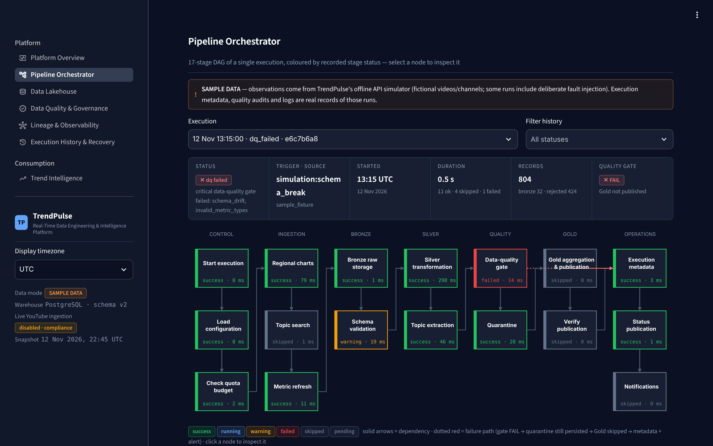
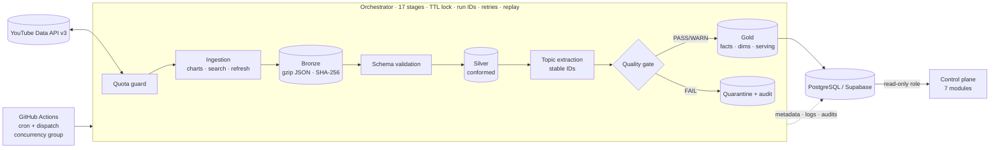
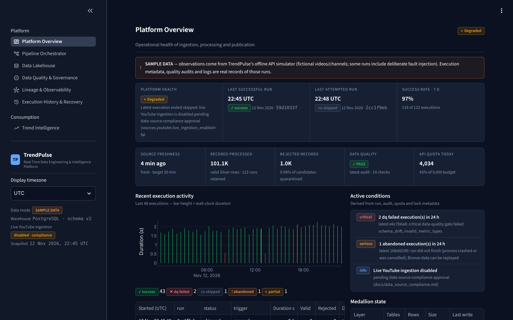
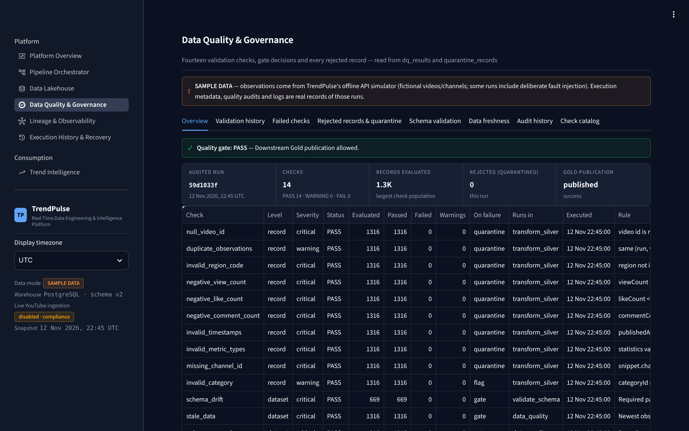
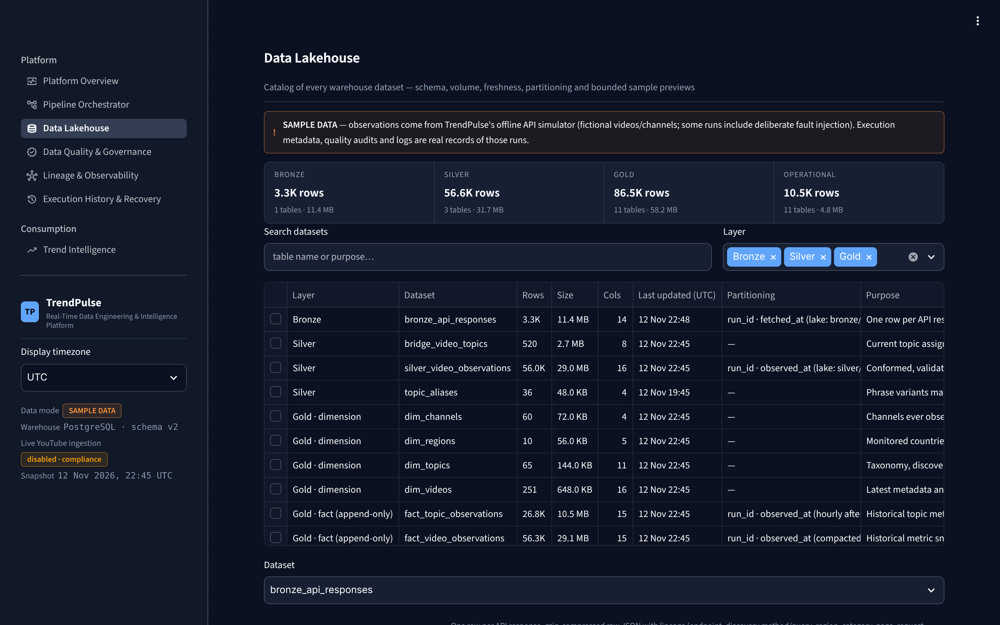
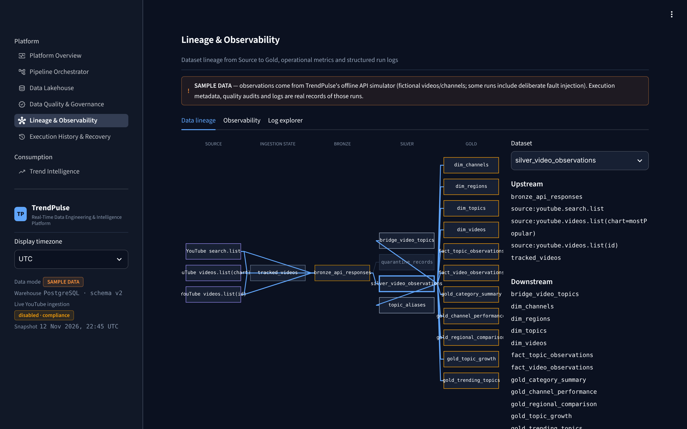
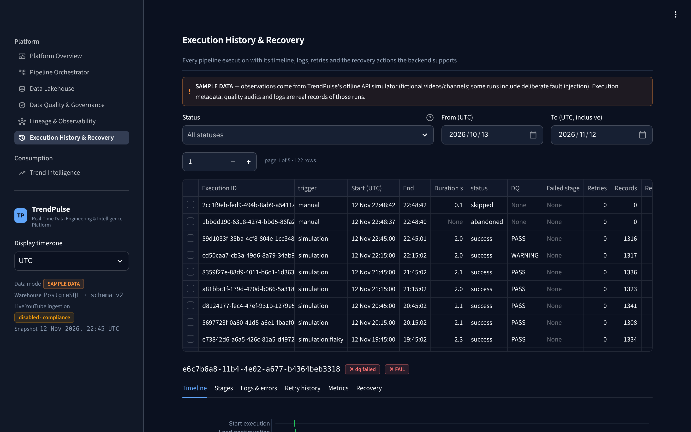
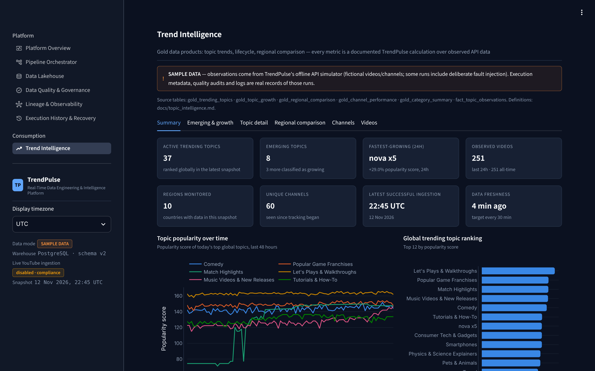

# TrendPulse — Real-Time Data Engineering & Intelligence Platform

[](../../actions/workflows/ci.yml)
  

TrendPulse is a data platform that ingests global topic signals, processes them through a
**Bronze → Silver → Gold medallion architecture**, enforces a **14-check data-quality gate**,
keeps **append-only history**, and exposes everything through an **engineering control plane**:
pipeline DAG, lakehouse catalog, quality governance, lineage, observability, structured logs,
execution history and authorised recovery. Trend analytics are the consumption layer on top.

> **The pipeline is the product; the dashboard is its control room.**
>
> **Status:** built and verified locally (SQLite + PostgreSQL 16). **Live YouTube ingestion is
> disabled** pending data-source compliance approval — see
> [docs/data_source_compliance.md](docs/data_source_compliance.md). All screenshots show runs
> against the offline API simulator (labelled SAMPLE), including deliberately injected faults.
> No public deployment exists yet.



## 1 · Engineering architecture



Details: [architecture](docs/architecture.md) · [orchestration](docs/pipeline_orchestration.md) ·
[technical design](docs/technical_design.md).

## 2 · Data ingestion

YouTube Data API v3 client with quota pre-check against a Pacific-day ledger, refresh reserve,
exponential backoff with full jitter, `Retry-After`, pagination and request logging (key never
logged). Hybrid discovery: regional `mostPopular` charts (10 countries × 3 charts), rotating
`search.list` seeds (6 every 3 h) and `videos.list` metric refresh of tracked videos.
Planned usage ≤ 7,728 of 10,000 units/day — [api_quota_strategy.md](docs/api_quota_strategy.md).

## 3 · Medallion architecture

| Layer | Tables | Properties |
|---|---|---|
| Bronze | `bronze_api_responses` | raw response per API call, gzip JSON, SHA-256, lineage metadata, committed on arrival, replayable |
| Silver | `silver_video_observations`, `bridge_video_topics`, `topic_aliases`, `quarantine_records` | tolerant parse, UTC, dedupe, record-level checks, rejected rows quarantined with raw payload |
| Gold | 4 dims, 2 append-only facts, 5 serving tables | one transaction per publication; failure never touches the published snapshot |

Catalog with schemas, row counts, sizes, partitions and samples: **Data Lakehouse** module and
[data_dictionary.md](docs/data_dictionary.md).

## 4 · Topic intelligence

Keyword taxonomy (56 topics) + TF-IDF keyphrase discovery with deterministic IDs and aliases;
popularity score, growth over 6 windows, velocity, acceleration, lifecycle — all documented
TrendPulse calculations: [topic_intelligence.md](docs/topic_intelligence.md).

## 5 · Data quality

14 checks (10 record-level, 4 dataset-level), PASS/WARNING/FAIL, `dq_results` audit row per check
per run, quarantine with the exact failed rule, gate that blocks Gold. Since this upgrade a FAIL
gate still persists its quarantine so the offending rows are inspectable.
[data_quality.md](docs/data_quality.md).

## 6 · Orchestration

17 declared stages (`orchestration/dag.py`: group, dependencies, conditions, input/output
datasets — tested against the executor), run/stage metadata in the warehouse, TTL lock,
DB-error retries, abandoned-run detection, persisted structured logs (schema v2).

## 7 · Recovery & reliability

Bronze-per-response persistence · idempotent facts (`run_id` keys) · single-transaction Gold ·
`trendpulse replay --run-id` · abandoned runs reconciled by replay · operator-only dispatch of
run/replay through GitHub Actions. Per-stage retry and historical backfill are **not offered**
(not supported by the backend / the API).

## 8 · Data lineage

Dataset-level lineage Source → Bronze → Silver → Gold derived from the declared stage
inputs/outputs; per-execution transformation metrics (records in/out, rejected, duration, DQ).

## 9 · Monitoring

Platform health (Healthy / Degraded / Failed / Stale / Not initialized, rules in `dashboard/ops.py`),
active conditions, throughput, stage durations, retry/error frequency, rejection rate, quota,
freshness by region, searchable logs, optional webhook/email alerts.

## The control plane (7 modules)

| Module | What an engineer does there |
|---|---|
| **Platform Overview** | health status with reasons, last successful vs last attempted run, success rate, freshness, records/rejections, DQ, quota, active conditions |
| **Pipeline Orchestrator** | interactive DAG of any execution from recorded stage metadata; click a node → stage inspector (datasets, timings, counts, attempts, errors, logs) |
| **Data Lakehouse** | catalog of all 26 tables by layer; search, schema/index inspector, paginated samples (payload columns never selected), partitions, lineage |
| **Data Quality & Governance** | gate decision, 14 checks, validation history heat-map, failed checks, quarantine browser with raw payload + violated rule, schema drift, freshness, audit history |
| **Lineage & Observability** | interactive lineage graph, per-run transformation metrics, operational charts, structured log explorer (search, severity, run, stage, time) |
| **Execution History & Recovery** | filterable, paginated history; timeline, stages, logs & stack traces, retry history, metrics; authorised replay / new run |
| **Trend Intelligence** | Gold data products (emerging/growth, topic detail, regional, channels, videos) |

| Platform overview | Data quality & governance |
|---|---|
|  |  |
| **Data lakehouse** | **Lineage & observability** |
|  |  |
| **Execution history & recovery** | **Trend intelligence** |
|  |  |

## 10 · Testing

```bash
ruff check src tests scripts streamlit_app.py
python scripts/check_secrets.py
pytest                                                    # SQLite warehouse
TRENDPULSE_TEST_DATABASE_URL=postgresql://… pytest        # same suite on PostgreSQL
```

Latest: **149 passed, 1 skipped** on SQLite (skip = PostgreSQL-only role test), **136 passed,
14 skipped** on PostgreSQL 16 (skips = page smoke tests that need the SQLite fixture), coverage
**93 %** of 3,799 statements (view modules excluded from measurement; they are exercised by page
smoke tests). Includes fault-injection scenarios, role-permission checks, empty/error states and
all 7 modules. Details: [DEVELOPMENT_PROGRESS.md](DEVELOPMENT_PROGRESS.md).

## 11 · Deployment

GitHub Actions (CI + ingestion) → Supabase PostgreSQL → Streamlit Community Cloud, $0.
Exact steps, secrets and repository variables: [deployment.md](docs/deployment.md).
Live ingestion remains off until compliance is resolved.

## Quick start (offline)

```bash
pip install -r requirements-dev.txt
trendpulse simulate --cycles 96 --chaos      # 48 h of SAMPLE runs incl. injected faults
streamlit run streamlit_app.py
```

Other commands: `trendpulse run | replay --run-id … | migrate | status | validate-config |
quota-plan | retention | export-parquet`.

## Documentation

[architecture](docs/architecture.md) · [data dictionary](docs/data_dictionary.md) ·
[data quality](docs/data_quality.md) · [orchestration](docs/pipeline_orchestration.md) ·
[deployment](docs/deployment.md) · [troubleshooting](docs/troubleshooting.md) ·
[security review](docs/security_review.md) · [data-source compliance](docs/data_source_compliance.md) ·
[topic intelligence](docs/topic_intelligence.md) · [API quota](docs/api_quota_strategy.md) ·
[technical design](docs/technical_design.md) · [audit (phase 0)](docs/audit/phase0_audit.md)

## Limitations

Live data blocked on YouTube policy approval; API exposes charts/search samples, not all of
YouTube; keyword/TF-IDF NLP (weak on unsegmented scripts); GitHub cron is best-effort; free
tiers (500 MB DB, sleeping Streamlit apps); single shared operator passphrase.

## Licence

MIT. YouTube is a trademark of Google LLC; this project is not affiliated with or endorsed by YouTube.
