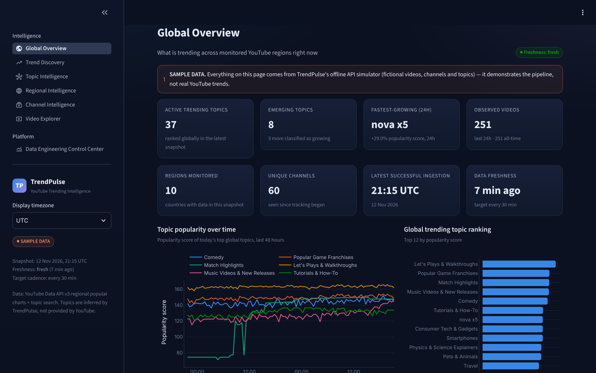
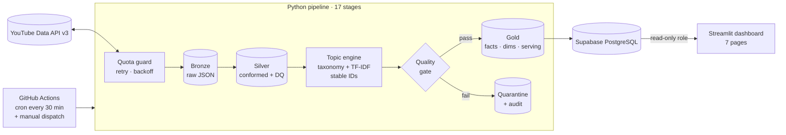
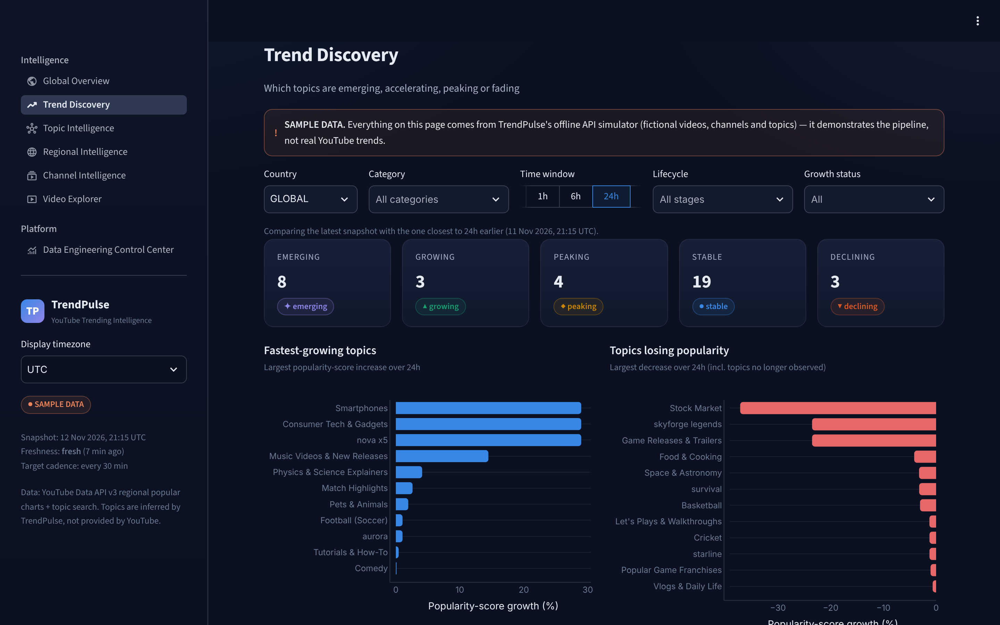
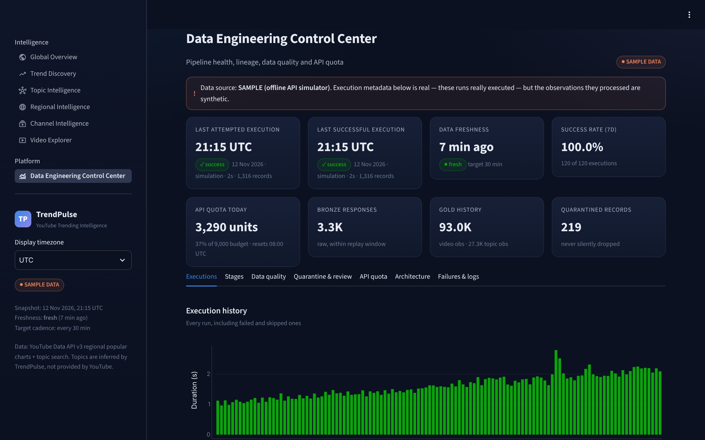
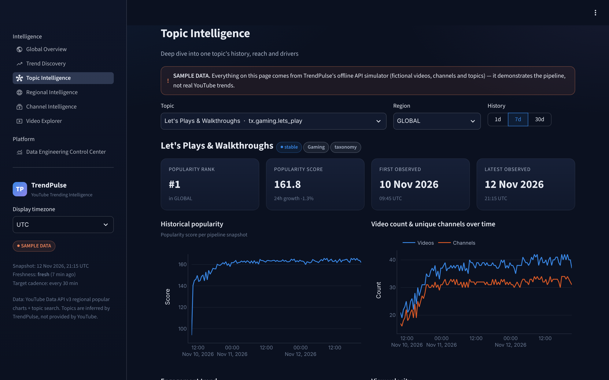
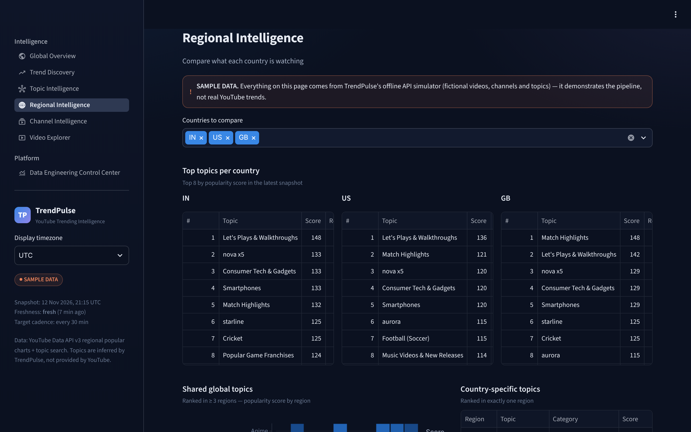

# TrendPulse — Global YouTube Trending Intelligence Platform

[](../../actions/workflows/ci.yml)
[](../../actions/workflows/ingest.yml)
 

TrendPulse is an end-to-end **data engineering platform** that discovers YouTube topics,
tracks how they **emerge, grow, peak and decline**, and compares them across ten countries.
It pulls from the YouTube Data API v3 every 30 minutes, lands the raw responses in a
**Bronze → Silver → Gold** medallion warehouse on PostgreSQL, gates every run on a 14-check
data-quality framework, infers topics with lightweight NLP, and serves a Streamlit dashboard
with a full pipeline **Control Center**.

> **Live demo:** _pending deployment_ — see [Deployment status](#deployment-status).
> Topics, scores, growth and lifecycle stages are **calculated by TrendPulse**, not provided by
> YouTube. Regional chart observations, search-discovered observations and inferred topics are
> labelled separately throughout.



## What it answers

| Question | Where |
|---|---|
| What topics are trending globally / in India right now? | Overview · Trend Discovery (country filter) |
| Which topics are growing fastest, which are losing popularity? | Trend Discovery (30m → 30d windows) |
| Growth rate, velocity and acceleration of a topic | Trend Discovery table · Topic Intelligence |
| How long has a topic stayed trending? | `consecutive_observations`, first/last observed |
| Popular in India but not in the US? | Regional Intelligence → *Popular here, absent there* |
| Which channels drive a topic? Which categories engage most? | Channel Intelligence · Overview |
| Topics emerging across multiple countries | Regional Intelligence → shared topics heat-map |
| How rankings changed over 24 h / 7 d / 30 d | rank change columns, topic history |

## Architecture



More: [architecture](docs/architecture.md) · [orchestration](docs/pipeline_orchestration.md) ·
[technical design & tool choices](docs/technical_design.md).

## Technology

Python 3.11 · YouTube Data API v3 · PostgreSQL (Supabase) · SQLite (local fallback) ·
SQLAlchemy Core · DuckDB · Parquet · pandas · scikit-learn · Streamlit · Plotly · Pytest ·
Ruff · GitHub Actions · Docker. No AWS, no paid services.

## Data source & API strategy

* **Regional popular charts** — `videos.list?chart=mostPopular` per country, uncategorised plus
  Music (10) and Gaming (20). Since July 2025 this chart follows YouTube's category charts rather
  than the retired general Trending page, so TrendPulse never relies on it alone.
* **Topic-oriented search** — `search.list` over 14 configurable seeds (AI, tech, gaming, music,
  sports, finance, news, science…), rotated across countries; 6 searches every 3 hours.
* **Metric refresh** — search-discovered videos are re-measured each cycle with `videos.list`
  (50 IDs per unit) for 72 h, instead of repeating 100-unit searches.
* **Quota**: planned ≤ 7,728 of 10,000 units/day, hard budget 9,000, refresh reserve 600,
  daily ledger in Pacific time. Details: [api_quota_strategy.md](docs/api_quota_strategy.md).

## Topic intelligence

Two layers: a curated **taxonomy** (11 categories, 56 topics, weighted keyword evidence →
confidence; low confidence goes to a review queue) and **discovered topics** (1–3-gram TF-IDF
keyphrases shared by ≥ 3 videos from ≥ 2 channels, entity-filtered, similar phrases merged).
Identities are deterministic (`dx_` + hash of a canonical key) with an alias table, so the same
topic keeps its ID across runs and rebuilds.

```
popularity = 20·ln(1+videos) + 10·ln(1+channels) + 8·log10(1+views/hour) + engagement%
growth %   = (current − previous) / previous × 100   (NULL when there is no honest baseline)
velocity   = Δ score / hour        acceleration = Δ velocity / hour
lifecycle  = baseline · emerging · growing · peaking · stable · declining · dormant
```

Full methodology and edge cases: [topic_intelligence.md](docs/topic_intelligence.md).

## Data model

Bronze `bronze_api_responses` → Silver `silver_video_observations`, `bridge_video_topics` →
Gold `fact_video_observations`, `fact_topic_observations`, `dim_videos`, `dim_channels`,
`dim_regions`, `dim_topics`, `gold_trending_topics`, `gold_topic_growth`,
`gold_regional_comparison`, `gold_channel_performance`, `gold_category_summary`.
Facts are append-only and keyed by `run_id`; serving tables are replaced atomically per run.
See the [data dictionary](docs/data_dictionary.md).

## Data quality

14 checks (null IDs, duplicates, region codes, negative metrics, timestamps, topic coverage,
categories, schema drift, staleness, volume anomalies, metric types, channel IDs) with
PASS / WARNING / FAIL, a `dq_results` audit row per check per run, quarantine with reasons and
raw payload, and a gate that blocks Gold publication. [data_quality.md](docs/data_quality.md).

## Reliability

Per-response Bronze persistence · TTL database lock + workflow concurrency group ·
retries with jittered backoff · single-transaction Gold publication · idempotent replay from
Bronze (`trendpulse replay --run-id`) · crashed runs marked `abandoned` · retention that compacts
whole runs · optional webhook/email alerts on failure and recovery.

## Quick start

```bash
git clone https://github.com/OWNER/trendpulse-youtube-trending-intelligence && cd trendpulse-youtube-trending-intelligence
python -m venv .venv && source .venv/bin/activate
pip install -r requirements-dev.txt

# Offline demo — 48 h of clearly-labelled SAMPLE data from the API simulator, local SQLite:
trendpulse simulate --cycles 96
streamlit run streamlit_app.py

# Real data:
cp .env.example .env        # set YOUTUBE_API_KEY (and DATABASE_URL for Postgres)
trendpulse run --force-search
```

Other commands: `trendpulse status | validate-config | quota-plan | replay --run-id … |
retention | export-parquet | migrate`. `make test` runs the suite.

## Testing

`pytest` — 108 tests (unit + integration), no API key or cloud account needed: HTTP mocked
with `responses`, end-to-end runs against the offline simulator, the same suite runs on SQLite
and PostgreSQL (`TRENDPULSE_TEST_DATABASE_URL`), plus Streamlit page smoke tests.
Coverage ≈ 93 % (dashboard view modules excluded from the measurement; they're exercised by
the page smoke tests). Latest results: [DEVELOPMENT_PROGRESS.md](DEVELOPMENT_PROGRESS.md).

## Deployment

GitHub Actions (CI + scheduled ingestion) → Supabase → Streamlit Community Cloud.
Step-by-step with exact secrets: [deployment.md](docs/deployment.md).
Problems: [troubleshooting.md](docs/troubleshooting.md). Security: [SECURITY.md](SECURITY.md).

### Deployment status

Code, tests, migrations, workflows and dashboard are complete and verified locally (SQLite and
PostgreSQL 16). Public deployment is waiting on account authorisation (YouTube API key,
Supabase project, GitHub repository, Streamlit app) — tracked in
[DEVELOPMENT_PROGRESS.md](DEVELOPMENT_PROGRESS.md#required-manual-actions).

## Screenshots

The screenshots in `docs/images/` were captured from a local run on **SAMPLE data** (offline
simulator — fictional videos and channels, visible SAMPLE banner). They show the interface,
not real YouTube trends.

| Trend discovery | Control center |
|---|---|
|  |  |
| **Topic intelligence** | **Regional intelligence** |
|  |  |

## Limitations

* The API exposes charts and search samples, not all of YouTube; topic popularity is relative
  to what is observed.
* Since July 2025 `mostPopular` is category-chart based (Music/Movies/Gaming-heavy).
* Search discovery is sampled (6 searches / 3 h) to fit the free quota.
* NLP is keyword/TF-IDF based; unsegmented scripts (Japanese, Korean) yield fewer discovered
  topics.
* GitHub cron is best-effort (delays of minutes are normal).
* Free tiers: Supabase 500 MB (handled by tiered retention), Streamlit apps sleep when idle.
* YouTube policies limit retention of API metadata (30 days) — see the compliance section.

## Cost

$0: GitHub Actions (public repo minutes are free), Supabase free plan, Streamlit Community
Cloud, YouTube API default quota. No credit card required.

## Future enhancements

Embedding-based topic clustering with the same identity layer · per-language tokenisers for
JP/KR · anomaly detection on topic velocity · dbt models over the Gold layer · partitioned
fact tables · a public read-only API over the serving tables.

## Licence

MIT — see [LICENSE](LICENSE). YouTube is a trademark of Google LLC; this project is not
affiliated with or endorsed by YouTube.
