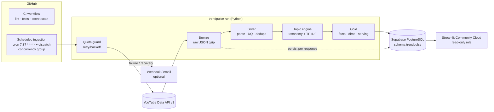
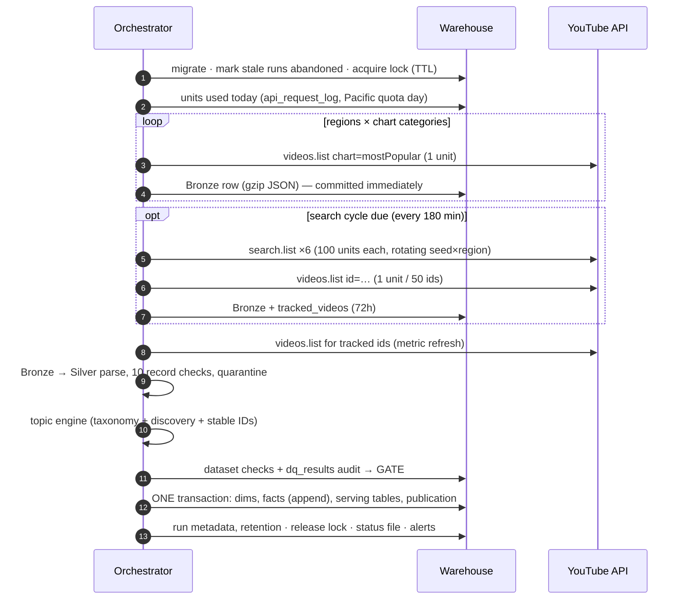
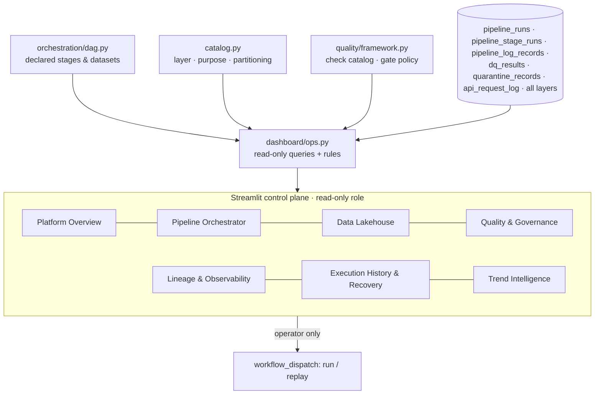

# Architecture

TrendPulse is a batch-incremental data platform: every 30 minutes a GitHub Actions job runs one
idempotent pipeline execution that pulls from the YouTube Data API, lands raw data (Bronze),
conforms and validates it (Silver), infers topics, and publishes analytics models (Gold) to
PostgreSQL. A Streamlit app reads Gold through a read-only role.

## System context



## Data flow (one execution)



## Medallion layers

| Layer | Tables | Grain | Mutability | Retention |
|---|---|---|---|---|
| Bronze | `bronze_api_responses` | one API response | append-only, immutable | 2 days (replay window) |
| Silver | `silver_video_observations` | run × video × region × discovery context | append-only | 2 days |
| Silver | `bridge_video_topics`, `topic_aliases` | video × topic / alias key | current state (upsert) | — |
| Gold facts | `fact_video_observations`, `fact_topic_observations` | run × video × region × context / run × topic × region | **append-only history** | full 2 d / 7 d, then compacted (see below) |
| Gold dims | `dim_videos`, `dim_channels`, `dim_regions`, `dim_topics` | entity | SCD-1 upsert (`first_observed_at` insert-only) | — |
| Gold serving | `gold_trending_topics`, `gold_topic_growth`, `gold_regional_comparison`, `gold_channel_performance`, `gold_category_summary` | latest published snapshot | replaced atomically per publication | — |
| Ops | `pipeline_runs`, `pipeline_stage_runs`, `pipeline_lock`, `api_request_log`, `dq_results`, `quarantine_records`, `gold_publications`, `discovery_state`, `tracked_videos`, `schema_migrations` | — | — | 30–90 days |

See [data_dictionary.md](data_dictionary.md) for every column.

### Why serving tables *and* facts?

Facts are the historical record — never overwritten, keyed by `run_id` for idempotency.
Serving tables are small, pre-computed answers for the dashboard (rankings, growth per window,
lifecycle) so a public page never runs heavy window queries against a free-tier database. They
are rebuilt from facts inside the same transaction that appends the facts, so they can never
disagree with history, and a failed run never leaves them half-written.

## Storage backends

| Concern | Choice | Why |
|---|---|---|
| Production warehouse | PostgreSQL (Supabase free tier) | Durable across redeploys, real constraints/transactions/`ON CONFLICT`, free, reachable from both GitHub Actions and Streamlit Cloud |
| Local / test warehouse | SQLite (automatic when `DATABASE_URL` is unset) | Zero setup; the same SQLAlchemy Core statements and upsert semantics run on both |
| In-run analytics | DuckDB over pandas frames | Columnar SQL for topic aggregation without round-trips; zero-copy |
| Local lake | Parquet (Silver per run) + gzip JSON (Bronze) under `data/lake/` | Replayable files; `trendpulse export-parquet` writes Gold to Parquet with a DuckDB view catalog |

Tables live in a dedicated `trendpulse` schema (via SQLAlchemy `schema_translate_map`), which
Supabase does **not** expose through its auto-generated REST API; migration 001 also revokes the
`anon`/`authenticated` roles from it.

## Storage budget

Supabase's free tier allows 500 MB, and the YouTube Developer Policies limit how long API data may be kept (see [api_quota_strategy.md](api_quota_strategy.md#compliance)). Measured on PostgreSQL 16 during a 60-hour simulation
(10 regions, 3 charts each, search every 3 h — the default config), see the table in
[DEVELOPMENT_PROGRESS.md](../DEVELOPMENT_PROGRESS.md#measured-storage). Tiered retention keeps
long-term growth bounded:

* `dim_videos` / `dim_channels`: deleted when not refreshed for 30 days (YouTube policy).
* `silver_video_observations`: 1 day; `bronze_api_responses`: 2 days.
* `fact_video_observations`: full 30-minute granularity for 1 day, then the last run of each
  UTC day, deleted after 30 days.
* `fact_topic_observations` (the core asset): full granularity for 3 days, the last run of each
  UTC hour until day 14, then the last run of each UTC day, kept 400 days. 7-day comparisons
  therefore resolve against hourly snapshots and 30-day comparisons against daily ones.
* Compaction deletes **whole runs**, never parts of a snapshot, and never interpolates.

All windows are configurable in `config/pipeline.yaml → retention`.

## Failure model

| Failure | Behaviour |
|---|---|
| API 429/5xx/timeouts | Exponential backoff with full jitter, `Retry-After` honoured, max 4 retries |
| API 400/404 (e.g. a category chart not offered in a region) | Logged, skipped, run continues |
| Daily quota budget reached / Google `quotaExceeded` | Discovery stops cleanly; run is `partial` and still publishes what it has |
| Process crash mid-run | Bronze already committed; lock expires (TTL); next run marks the row `abandoned`; `trendpulse replay --run-id` rebuilds Silver/Gold from Bronze |
| Data-quality gate FAIL | Run is `dq_failed`; audit + quarantine written; **Gold untouched** |
| Error during publication | Single transaction rolls back facts, dims and serving tables together |
| Transient DB error | Stage retried (2×) with backoff |
| Two runs at once | GitHub `concurrency` group + DB lock (`skipped_locked`) |

## Code layout

```
src/trendpulse/
  settings.py            config + env overrides (pydantic-validated)
  ingestion/             youtube_client (retries, quota) · quota · discovery · bronze · sample simulator
  transform/silver.py    Bronze → Silver parser (tolerant; issues recorded for DQ)
  quality/framework.py   14 checks, quarantine, audit, gate
  topics/                normalize · classifier (taxonomy) · discovery (TF-IDF) · registry (stable IDs) · engine
  gold/                  metrics (pure formulas) · builder (facts, serving, publication)
  orchestration/         17-stage pipeline, locks, replay, run metadata
  monitoring/alerts.py   webhook / SMTP
  storage/               schema · db (engine, upserts, locks) · migrations · retention
  dashboard/             data access (pure) · runtime (cache, secrets) · components · 7 views
  cli.py                 trendpulse run | simulate | replay | migrate | status | …
```

## Control plane (engineering-first UI)



Separation of concerns: page modules (`dashboard/views/*`) only lay out widgets; queries and
business rules (health status, action availability, lineage) live in `dashboard/ops.py`; figure
construction in `dashboard/figures.py`; design tokens and components in `dashboard/components.py`.

Schema v2 (additive) adds `pipeline_log_records`. No existing table changed.

Measured query latency on PostgreSQL 16 as the reader role (122 runs, ~100k fact rows): platform
health 17 ms, run page 8 ms, DAG state 11 ms, catalog 51 ms, log search 4 ms, lineage metrics
20 ms, Silver partitions 68 ms. Queries are cached for 60–120 s and every list is limited or paged.
