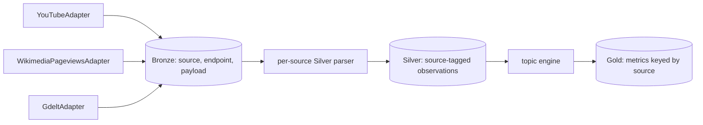

# Data-source compliance — YouTube Data API v3

**Status: live YouTube ingestion is DISABLED** (`sources.youtube.live_ingestion_enabled: false`).
It stays disabled until the use case below is approved by Google or confirmed in writing. Until
then the platform runs on its offline simulator (clearly labelled SAMPLE data).

This is an engineering review of published policy text, not legal advice. Policies change —
re-check the sources below before enabling live ingestion.

## Sources reviewed (13 Nov 2026)

* YouTube API Services — Developer Policies guide:
  <https://developers.google.com/youtube/terms/developer-policies-guide>
* YouTube Additional Policies for Derived Metrics and Data Storage (page last updated
  2026-09-14): <https://developers.google.com/youtube/terms/derived-metrics-policy>
* Also to read in full before enabling: YouTube API Services Terms of Service and the full
  Developer Policies (section III.E on data storage/refresh).

## What TrendPulse does with API data

| Operation | Where | Data involved |
|---|---|---|
| Collect regional `mostPopular` charts and keyword search results | ingestion | public video metadata + statistics (no OAuth, no user data) |
| Store statistics over time (views/likes/comments per observation) | `fact_video_observations` | statistics |
| Store metadata (titles, channel names, descriptions, tags) | `dim_videos`, `dim_channels`, Bronze | non-statistical API data |
| **Aggregate across many channels/videos** into topics and regions | `fact_topic_observations`, serving tables | derived |
| **Derived metrics**: popularity score, growth %, velocity, acceleration, lifecycle, rankings/leaderboards, engagement rate | Gold | derived |
| Topic tags (TrendPulse categories) next to YouTube's own category | `bridge_video_topics`, `dim_topics` | derived, additive |
| Public display on a dashboard | Streamlit | derived + API statistics |

## Relevant restrictions (summarised from the policy pages)

1. **Derived / independently calculated metrics.** The guide says not to use the API to offer
   independently calculated or derived metrics that replace API data or provide new data not
   available via the API; simple arithmetic over API data only, with no external data sources.
   It lists custom channel "scores" based on averages/ratios and graphs of raw-metric increases as
   examples.
2. **Analytics & Reporting amendment.** The additional policies apply to *audited developers with
   analytics use cases* that have explicitly applied (through the standard **quota extension
   request**, starting 1 June 2026) for permission to create additional metrics and/or store
   statistical data. *Without that permission, don't create derived metrics or store data beyond
   what the developer policies allow.* With it: leaderboards/historical comparisons and content
   tags are allowed in principle; statistics and derived metrics may be stored up to 36 months;
   derived metrics must be distinguishable from API data; tags must not replace YouTube categories.
3. **Non-statistical data** (titles, creator names, descriptions) remains subject to the 30-day
   refresh/deletion rule (Developer Policies section III(4), as referenced by the derived-metrics
   page).
4. **Aggregation.** The guide restricts compiling/aggregating *authorized* API data (OAuth data)
   unless only the owner can see it. TrendPulse uses no authorized data — but this should be
   confirmed with Google rather than assumed.
5. **Combining with other data.** Do not merge YouTube API data with other sources; if displayed
   next to other platforms' data, the difference must be clear.
6. **Display.** Do not display metrics that replace or misrepresent YouTube's (e.g. a different
   "total views" number).

## Assessment of the intended use

| Operation | Assessment without approval | With Analytics & Reporting approval |
|---|---|---|
| Fetch + show charts/search results, refresh within 30 days | Allowed (standard use) | Allowed |
| Store per-video statistics history | **Not permitted beyond standard limits** | Allowed ≤ 36 months |
| Topic aggregation across channels | **Unclear** — derived data; ask Google | Likely allowed as analytics, confirm |
| Popularity score, growth, velocity, lifecycle, rankings | **Not permitted** (derived metrics) | Allowed if distinguishable and not replacing API metrics |
| TrendPulse topic tags | **Not permitted** (derived data) | Allowed as additive tags |
| Public dashboard of the above | Not permitted | Allowed if labelled as third-party analysis |

Conclusion: the core product (historical, cross-channel, derived trend metrics) **requires the
Analytics & Reporting approval**. Hence the default-off switch.

## Required permissions / actions

1. Google Cloud project with YouTube Data API v3 enabled and a restricted key.
2. Submit the **quota extension / audit request** describing the analytics use case: public
   chart + search data, cross-channel topic aggregation, derived trend metrics, 30-minute
   refresh, public dashboard, retention plan below.
3. Accept the Analytics & Reporting policy amendment once offered.
4. Record the approval reference and enable:

   ```yaml
   sources:
     youtube:
       live_ingestion_enabled: true
       compliance_approval_reference: "Google ticket 1234 / approved 2026-12-01"
   ```

   or `TRENDPULSE__SOURCES__YOUTUBE__LIVE_INGESTION_ENABLED=true` and
   `TRENDPULSE__SOURCES__YOUTUBE__COMPLIANCE_APPROVAL_REFERENCE=…` as repository variables.
   The pipeline refuses to run live with an empty reference.

## Retention plan (already implemented)

| Data | Retention |
|---|---|
| Bronze raw responses | 2 days |
| Silver observations | 1 day |
| Video/channel metadata not refreshed | deleted after 30 days |
| Video-level statistics history | 30 days |
| Topic-level derived metrics | 400 days (≤ 36 months; **set to 30 without approval**) |
| Quarantined payloads | 30 days |

## Display controls (already implemented)

* Every derived metric is labelled as calculated by TrendPulse; formulas are documented.
* YouTube's category is shown separately from TrendPulse categories.
* Lifetime view counts are shown as YouTube reports them — never replaced by a TrendPulse number.
* Each video links to YouTube.

## Outstanding questions for Google

1. Does cross-channel *topic* aggregation of public (non-authorized) data fall under the
   Analytics & Reporting amendment, or is it otherwise restricted?
2. Is a public (non-authenticated) dashboard of derived trend metrics acceptable under the
   amendment, given labelling as third-party analysis?
3. Do `mostPopular` chart positions count as statistics that may be stored historically?
4. Is a 30-minute refresh cadence acceptable for the quota/audit review?

## Alternative sources (proposal only — not implemented)

If approval is refused or delayed, TrendPulse's pipeline is source-agnostic past Bronze in
principle; a **source adapter** layer would make that explicit:



| Candidate | Measures | Licence / terms | Fit |
|---|---|---|---|
| Wikimedia Analytics (pageviews API, top articles per project/country) | attention to Wikipedia articles | open data, attribution | strong for "global topic interest", has history + per-country tops |
| GDELT 2.0 (events / GKG, 15-min updates) | news coverage of themes/entities | open with attribution | strong for news-driven topics |

Rules for any migration: a separate design document and decision; each source keeps its own
metrics (`source` column everywhere), no blended "popularity" across sources, and the dashboard
names the source on every chart. No source change is made silently.
