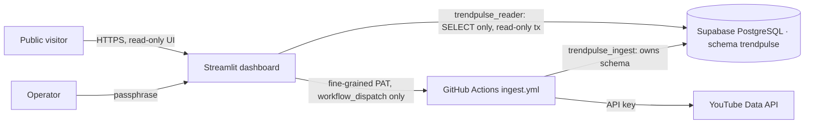

# Security review

Scope: pipeline, warehouse, CI/CD, public control plane (dashboard) and operator actions.
Last reviewed: 13 Nov 2026 (engineering control-plane upgrade). Findings marked
**verified** were executed against PostgreSQL 16 in the build environment; **designed**
items are implemented but depend on external services that were not available.

## Trust boundaries

The dashboard never executes pipeline code and never holds write credentials.

## Controls

| Asset / threat | Control | Status |
|---|---|---|
| API key leak | Key only in GitHub secret / local `.env` (git-ignored); stripped from logged params; log filter redacts `AIza…` and `key=` patterns, also in persisted `pipeline_log_records` | verified (unit test + log redaction) |
| DB credential leak | Separate ingest and reader roles; Postgres URL passwords redacted in logs; no credentials in code (secret scan + gitleaks in CI) | verified |
| Dashboard writes | `trendpulse_reader`: USAGE + SELECT, `default_transaction_read_only=on`, 30 s statement timeout; app also opens the engine read-only (`SET SESSION CHARACTERISTICS … READ ONLY`, `Warehouse(read_only=True)` refuses writes) | **verified**: INSERT/DELETE fail with `ReadOnlySqlTransaction` (automated test `test_reader_role_is_read_only_and_cannot_see_raw_payloads`) |
| Raw payload exposure | Reader has a **column-level** grant on Bronze metadata (ids, endpoint, region, checksum, item count, timestamps); `payload_gz` not granted; the catalog also never selects hidden columns | **verified**: `SELECT payload_gz` fails with `InsufficientPrivilege` |
| Supabase REST exposure | Tables live in schema `trendpulse` (not exposed by PostgREST); `anon`/`authenticated` revoked | verified locally (roles simulated); designed for Supabase |
| Public users triggering runs | No action executes in the dashboard. Operator actions dispatch `ingest.yml` and require deployment secrets (PAT + repo + passphrase) **and** an operator session (constant-time compare, 5 failures → 15-min lockout, 60-min session) | verified (unit tests: auth, availability matrix) |
| Workflow input injection | `run_id` validated as a lowercase UUID in the UI, in `trigger.dispatch`, and again in bash inside the workflow; inputs passed via `env:`, never interpolated into scripts; `action` restricted to `run`/`replay` | verified (unit tests) / designed (workflow) |
| Expensive/unauthorised ingestion | Live YouTube ingestion disabled by default (compliance switch requires an approval reference); scheduled job only starts when the repository variable enables it; quota budget guard | verified (pipeline + CI step) |
| Configuration changes from UI | Not possible by design — config changes go through git review | n/a |
| Destructive actions | None exposed. Replay is idempotent (facts keyed by `run_id`, single-transaction publication, refuses to overwrite a newer snapshot) | verified (tests) |
| XSS via API strings | HTML built with `html.escape`; tables via `st.dataframe`; JSON payloads via `st.json` | reviewed |
| SQL injection | SQLAlchemy Core bound parameters only (search → bound `LIKE`); table names in the catalog come from the schema metadata, never from user input | reviewed |
| Concurrency abuse | GitHub concurrency group + TTL DB lock | verified (tests) |
| Supply chain | Small dependency set, bounded versions; enable Dependabot + push protection | recommended |

## Least-privilege matrix

| Principal | Where | Privileges |
|---|---|---|
| `trendpulse_ingest` | GitHub Actions secret `DATABASE_URL` | owns schema `trendpulse` (DDL for migrations, DML); no database-level CREATE needed (verified) |
| `trendpulse_reader` | Streamlit secret `DASHBOARD_DATABASE_URL` | USAGE, SELECT on all tables except Bronze payload; read-only transactions |
| `GITHUB_TOKEN` in workflows | Actions | `permissions: contents: read` |
| Dispatch PAT (optional) | Streamlit secret | fine-grained, single repository, Actions read/write only |

## Findings fixed in this upgrade

1. Secret scan failed on `docker-compose.yml` (local password literal) — now uses
   `${LOCAL_PG_PASSWORD:-…}`.
2. Reader role could not read any Bronze column — replaced by a column-level grant that still
   excludes the payload.
3. Operator trigger had no lockout or session expiry — added.
4. Workflow could not replay; the new `action`/`run_id` inputs are validated and passed via env.

## Residual risks

* A single shared operator passphrase is coarse; for multiple operators put the app behind an
  identity provider (e.g. Cloudflare Access / Streamlit's built-in auth with OIDC) instead.
* Supabase pooler + custom roles must be verified after project creation (documented test).
* Streamlit Community Cloud apps are public by design — never add private data sources.
* Rotate the API key, DB passwords and PAT if any secret appears in a public log.
